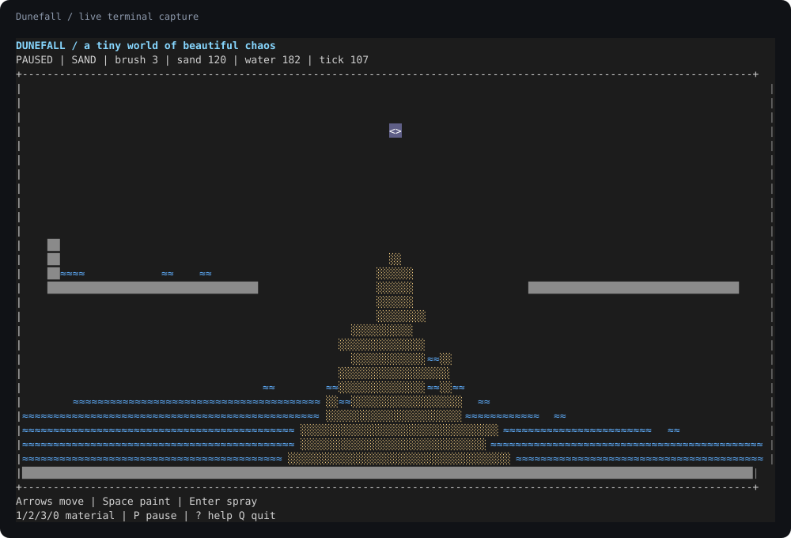

# Dunefall

A tiny world of sand, water, and beautiful chaos.

A playable C++20 terminal sandbox. Pour water, pile up sand, build dams, then
break them. Sand sinks through water; water flows around obstacles. Everything
runs locally, with no game framework or runtime downloads.



*Captured from the real program: a sand stream meeting a pool of water.*

## Build and play

Linux, an ANSI-compatible terminal, and a C++20 compiler are required. Development
setup also uses Bash 4+, Python 3, and
[uv](https://docs.astral.sh/uv/getting-started/installation/).

```bash
git clone git@github.com:arnavsx3/Dunefall.git
cd Dunefall
./scripts/bootstrap.sh
./scripts/dev.sh build release
./build/release/bin/dunefall
```

Already set up? Run `./scripts/dev.sh run` for the Debug build. The default world
includes a sand-and-water demo; add `--empty` for a blank canvas or `--seed 7` to
choose the random seed. The terminal must be at least **42 columns by 12 rows**.

## Controls

| Key | Action |
| --- | --- |
| Arrows / `h j k l` | Move the brush |
| Space | Paint once |
| Enter | Toggle continuous spray |
| `1` / `2` / `3` / `0` | Sand / water / wall / eraser |
| `e` | Select the eraser |
| `+` / `-` (or `]` / `[`) | Increase / decrease brush size |
| `p` | Pause / resume |
| `n` | Advance one physics step while paused |
| `c` | Clear the world |
| `d` | Reload the demo |
| `?` | Open / close help |
| `q` / Ctrl+C | Quit and restore the terminal |

Letter shortcuts also accept uppercase. Brushes are circular, from one to eleven
cells across. Sand and water fill empty cells; walls replace particles, and the
eraser removes any material. Painting works while paused. Continuous spray runs
with the simulation.

Resize freely: the world stays intact and the view follows the cursor. Help and
undersized terminals pause physics automatically. Clear and demo reload reset the
simulation seed and tick counter while preserving your selected tool and pause state.

## Headless snapshots and benchmarks

```bash
./build/release/bin/dunefall --headless --seed 7 --width 40 --height 16 --steps 120
./build/release/bin/dunefall --benchmark --width 120 --height 44 --steps 2000
./build/release/bin/dunefall --help
```

These modes work in scripts and pipes without ANSI escapes. Snapshot symbols are
`.` empty, `s` sand, `w` water, and `#` wall. The same scene, seed, dimensions, and
step count reproduce the same snapshot. See [performance notes](docs/performance.md).

## Development

```bash
./scripts/dev.sh check           # Formatting, Debug build, and tests
./scripts/dev.sh check release   # Optimized build and tests
./scripts/dev.sh check sanitize  # AddressSanitizer and UndefinedBehaviorSanitizer
./scripts/dev.sh format          # Format C++ files
```

CMake, Ninja, and clang-format are pinned and installed inside `.tools/venv/`.
Generated builds stay in `build/`. Both directories are ignored by Git. Python is
used for developer tooling and tests; the game itself is C++ and POSIX terminal APIs.

```text
Dunefall/
├── .github/workflows/       # CI across all three build presets
├── docs/                   # Architecture, roadmap, performance, demo assets
├── include/dunefall/        # Public app, simulation, and terminal interfaces
├── scripts/                # Bootstrap and developer commands
├── src/
│   ├── app/                # CLI, fixed-step clock, game coordination, headless mode
│   ├── simulation/         # Grid, materials, movement rules, demo scene
│   └── terminal/           # Safe session, keyboard decoding, cached rendering
├── tests/                  # Native checks, CLI tests, pseudo-terminal integration
├── tools/                  # Pinned toolchain and standard-library demo recorder
├── CMakeLists.txt
└── CMakePresets.json
```

## Demo and project notes

[Watch the terminal recording](docs/assets/demo.cast) with an asciinema-compatible
player, or regenerate it with `python3 tools/record_demo.py` after building Release.
The recorder also exports the SVG preview above and needs only Python's standard library.

Read the [development guide](docs/development.md), [architecture](docs/architecture.md),
[completed roadmap](docs/roadmap.md), [changelog](CHANGELOG.md), and
[contribution guide](CONTRIBUTING.md).
